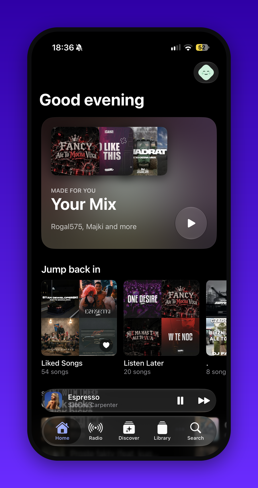
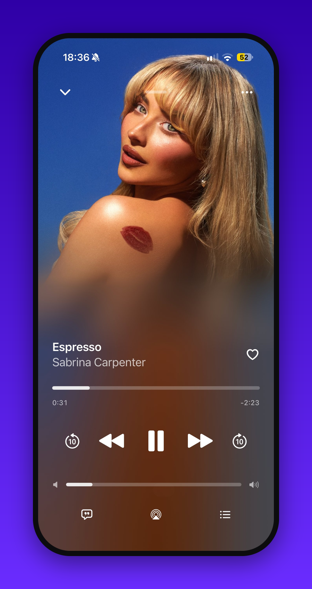
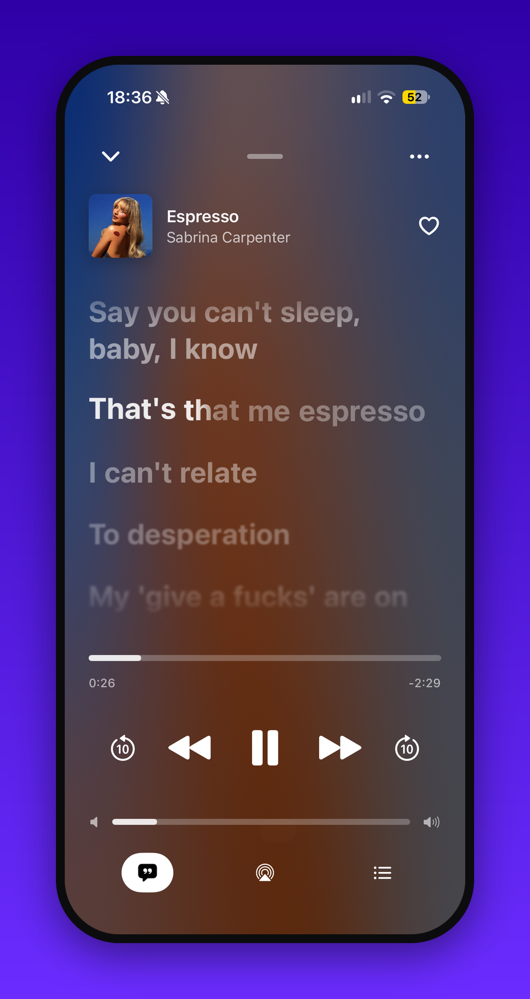
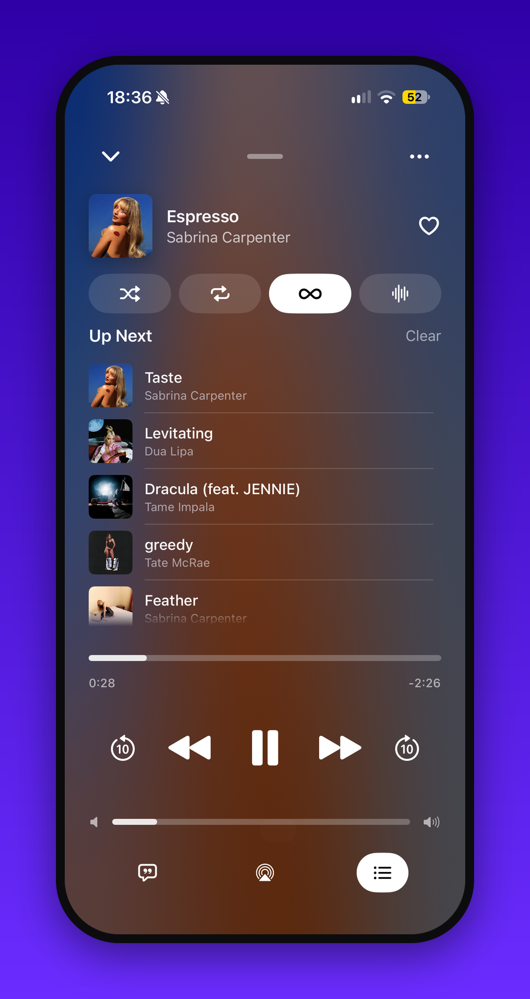
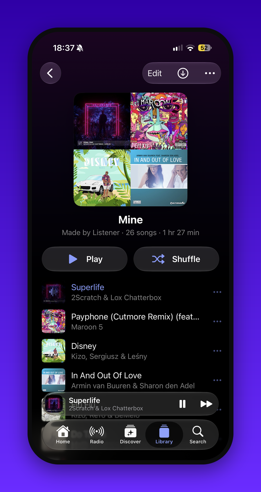
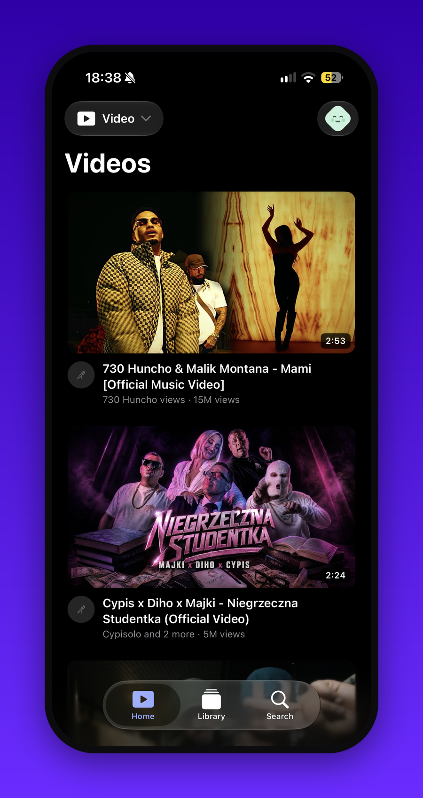
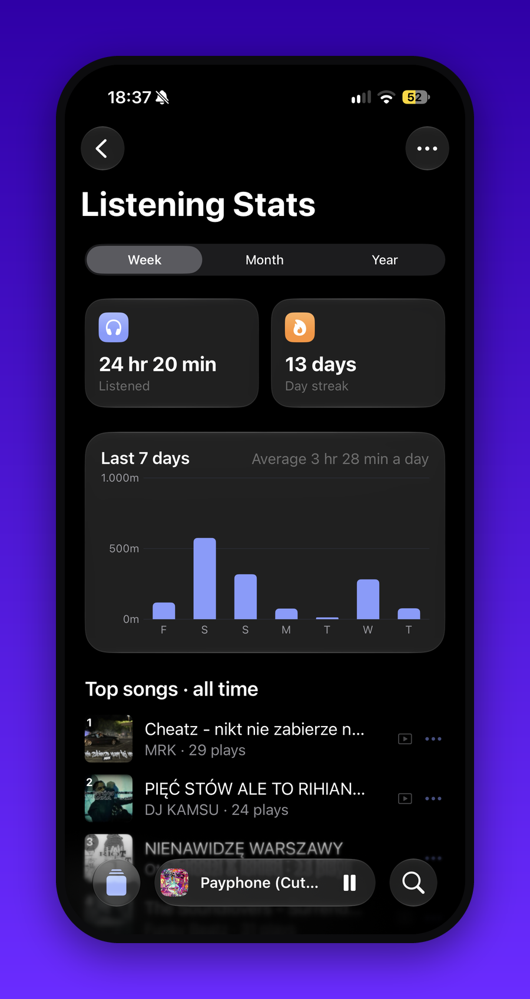
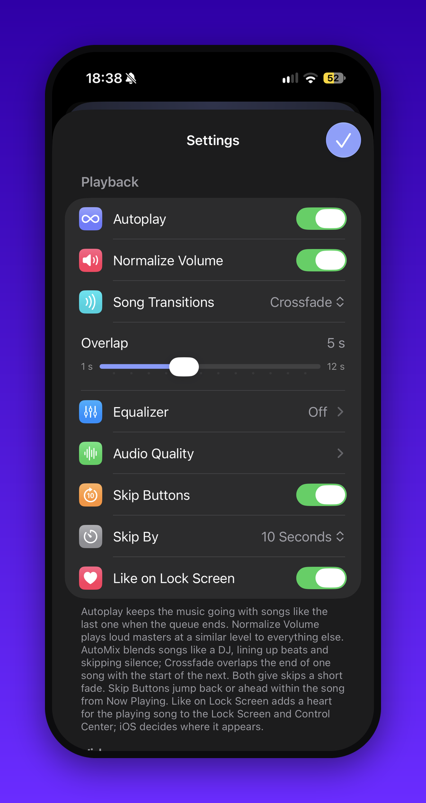

<p align="center">
  
</p>

<h1 align="center">Koda for iPhone</h1>

<p align="center">
  <b>YouTube Music and YouTube, in one app written in SwiftUI with Liquid Glass.</b>
</p>

<p align="center">
  <a href="https://github.com/Nushis1/iKoda-codemagic/releases/latest">
    
  </a>
  &nbsp;
  
  
  &nbsp;
</p>

Koda plays music from YouTube Music and videos from YouTube, without ads. Use it with no account at all, or sign in to bring your likes, playlists, subscriptions and history with you. It is the Apple sibling of [Koda for Android](https://github.com/Ivorisnoob/Koda).

> **About this project.** Koda for iPhone is continued by [Nushis1](https://github.com/Nushis1). The original project was created by [Ivorisnoob](https://github.com/Ivorisnoob): [Ivorisnoob/iKoda](https://github.com/Ivorisnoob/iKoda), Koda for iOS, a SwiftUI music player for YouTube Music with Liquid Glass.

<h1 align="center">Screenshots</h1>
<table>
  <tr>
    <td align="center" width="25%"><br><sub>Home</sub></td>
    <td align="center" width="25%"><br><sub>Now Playing</sub></td>
    <td align="center" width="25%"><br><sub>Synced Lyrics</sub></td>
    <td align="center" width="25%"><br><sub>Up Next</sub></td>
  </tr>
  <tr>
    <td align="center"><br><sub>Playlist</sub></td>
    <td align="center"><br><sub>Videos</sub></td>
    <td align="center"><br><sub>Listening Stats</sub></td>
    <td align="center"><br><sub>Settings</sub></td>
  </tr>
</table>

<h1 align="center">Installing</h1>

Koda isn't on the App Store, so you sign it yourself with your Apple ID, using any of these:

| Tool | How |
|---|---|
| [AltStore](https://altstore.io) | With AltServer running on your computer, open AltStore on the iPhone, go to **My Apps**, tap **+** and pick `Koda.ipa`. |
| [SideStore](https://sidestore.io) | The same, without needing a computer after setup. |
| [Sideloadly](https://sideloadly.io) | Connect the iPhone to your computer, drop `Koda.ipa` in, sign in and start. |

A free Apple ID's signature lasts seven days; AltStore and SideStore renew it for you. The first time, iOS may ask you to trust your Apple ID in **Settings → General → VPN & Device Management**.

Because the app is signed with a developer account, not by Apple, iOS needs **Developer Mode** on: **Settings → Privacy & Security → Developer Mode**. It appears after the first install, takes one restart and costs nothing. Without a paid Apple Developer account there is no way around it.

**Settings → Renewal** shows how many days are left on that signature, with reminders before it runs out and shortcuts to SideStore, AltStore and the Shortcuts app. There you can also sign in with your Apple ID and read your developer account (team, app IDs, certificates). Renewing is still done with Sideloadly on a computer or with SideStore on the phone.

If Sideloadly fails on a free Apple ID (free accounts have a small limit on app IDs, and the Quick Play widget needs its own), open **Advanced Options** and turn on removing app extensions. Koda then installs without the widget and controls.

<h1 align="center">Music and Video</h1>

<p align="center">Koda has two modes, as Koda for Android does. Switch between them from the button at the top of Home on the iPhone; each has its own tabs, and whatever is playing carries on.</p>

<h1 align="center">Features</h1>

<h1>Music</h1>

- **Your Mix** on Home, woven from radios of the artists you play most; **Jump back in**, **Quick picks**, your top artists and a row of **Charts**
- Signed in, Quick picks come from your own YouTube Music Home
- Gapless playback, **crossfade** or **AutoMix**, in the background, with the Lock Screen, Control Center and AirPlay, and a like button on the Lock Screen
- A **Radio** tab made from your own listening, a ten-band **equalizer**, audio quality for Wi‑Fi and cellular, and animated cover art
- Shuffle, repeat, autoplay radio, and a queue you can drag, swipe and undo
- Skip buttons, a sleep timer, volume normalization, and swiping the mini player to skip

<h1>Video</h1>

- **Home** and **Subscriptions** feeds, search, and channels with their Videos and Live tabs, sorted by Latest, Popular or Oldest, and an About page with their links
- **Explore** Music, Live, News, Sports and Learning, signed in or not
- **Watch Later** and **Liked Videos** from your account, and the channels you follow
- Like and dislike with the count, subscribe, share, and read the comments
- Koda's own player: quality (1080p by default, or Auto up to 4K), speed, captions, AirPlay and picture in picture
- **Gestures**: double-tap a side to skip 10 seconds (keep tapping to skip more), hold for 2× and slide for other speeds, swipe up for full screen and down to leave it or shrink the video into the mini player, brightness on the left in full screen, and pinch to fill the screen
- Videos **pick up where you left off**, with a progress bar on each thumbnail, and the next one plays after a short countdown
- Leave the video's page and it keeps playing in the mini player

<h1>Your account and profiles</h1>

- Sign in to YouTube Music to sync liked songs, albums, playlists and artists both ways, and to send what you play and watch to your YouTube history
- **Profiles** for everyone who uses the device, each with its own library, history and account, and a one-tap switch between them
- A welcome on first launch that sets up your taste: artists, genres and a deck of songs to keep or skip
- **Suggest Less** for songs and artists you don't want offered again, **Blocked Phrases** that keep any song with that phrase in its title out of radio, mixes and autoplay, and a full listening **History**

<h1>Lyrics</h1>

- Word by word from YouLyPlus and BetterLyrics, line by line from LRCLIB, chosen automatically
- Duets on their singer's side, backing vocals under their line, long notes that swell
- Tap a line to jump to it; share up to six lines as a card in the song's colours
- **Translation** or **pronunciation** under each line, and timing you can shift earlier or later per song

<h1>Finding music</h1>

- Search with suggestions and filters, or by voice, recognized on the device
- **Discover**: a tab of songs to swipe through, right to like, left to skip, down to keep in a Listen Later playlist; every answer teaches the next songs, so it fits your taste better as you go
- **Music Recognition**: tap the waveform in Search and Koda listens, names the song and plays it; paste a TikTok or YouTube link instead to find the song in a video
- Paste a YouTube or YouTube Music link to open it; `koda://` links work from Shortcuts
- Moods and genres to browse

<h1>Your library</h1>

- Liked songs, saved albums, playlists and artists, and playlists of your own, with a photo and a description
- **Lock a playlist with Face ID**: it opens and plays only after you unlock it
- **Play This Song** plays one song of a playlist on its own, followed by its radio; tapping a song in Your Library search does the same
- **Find Duplicates** and **Suggested Songs** in a playlist, and **Pins** at the top of Library
- Search inside your library by title, artist or album
- **Import a playlist** from Spotify or SoundCloud: tap New Playlist, choose where from, and paste the link of a public playlist; Koda finds each song on YouTube Music and lists the ones it couldn't (Spotify shows only a playlist's first 100 songs)
- **Downloads** and **Ready Offline**: songs kept on the device as you play them, to listen without a connection
- Listening stats: time listened each day, streaks, top songs and artists
- Back up the whole library to one file, or import it from Koda for Android
- An automatic copy of **every profile** (likes, history, stats, playlists and their locks, searches, blocked phrases) in the iPhone's Keychain, which survives deleting the app, so a reinstall brings it all back by itself, signed-in accounts included (same Apple ID; Settings → Back Up and Restore)

<h1>Siri, Shortcuts and widgets</h1>

- Ask Siri or Shortcuts to play your liked songs, a playlist or anything you name, start a radio, or like the song playing; Koda's songs and playlists show up in Spotlight
- A **Quick Play** widget for the Home Screen and Lock Screen, and Control Center controls on the iPhone


<h1 align="center">Privacy</h1>

Koda has no analytics and no server of its own. What you like, save, play and search is stored on your device and leaves it only when you back it up, or, if you sign in, to keep your YouTube account in step. Your sign-in stays in the device's Keychain. Requests go to YouTube and YouTube Music, to the lyrics services for lyrics, and to Last.fm or Discord only if you turn them on. Pausing listening history keeps your plays from going anywhere.

<h1 align="center">Building</h1>

Xcode 26 or later. Notes on how parts of Koda work, and why, are in [`docs/`](docs).

```sh
cd KodaCore && swift test                          # unit tests
KODA_LIVE=1 swift test --filter Live               # against live YouTube, plays muted audio
xcodebuild -project Koda.xcodeproj -scheme Koda -destination 'generic/platform=iOS' build
```

CI runs on Codemagic and is defined in `codemagic.yaml`; builds and their artifacts are on the Codemagic Builds page. It has two workflows:

| Workflow | Runs | Result |
|---|---|---|
| `ios-unsigned` | Every push to `main` or `beta`, and pull requests | Tests `KodaCore`, then builds `Koda.ipa` with an ad-hoc signature, for AltStore, SideStore and Sideloadly, which re-sign it with your Apple ID (free) |
| `ios-signed` | Only when you start it by hand | An Ad Hoc signed `Koda.ipa` for iPhones registered in your Apple Developer account. Needs a paid Apple Developer Program account, an App Store Connect API key, and a `code-signing` variable group holding `CERTIFICATE_PRIVATE_KEY`; the steps are at the top of `codemagic.yaml` |

To use it, add the repository in Codemagic, choose `codemagic.yaml`, and create the webhook in the app's settings. The old GitHub Actions workflow is gone.

| Path | What |
|---|---|
| `KodaCore/` | Swift package with no UI: the InnerTube clients, parsers, stream resolution, accounts, lyrics, the library, the queue and the player |
| `Koda/` | The SwiftUI app, with video in `Koda/Video` |
| `KodaWidgets/` | The Quick Play widget and Control Center controls |
| `codemagic.yaml` | Codemagic CI: the `ios-unsigned` and `ios-signed` (manual) workflows |

<h1 align="center">Feedback</h1>

<p align="center">Found a bug, have a suggestion, or want to request a feature? <a href="https://github.com/Nushis1/iKoda-codemagic/issues">Open an issue</a>.</p>

<h1 align="center">Thanks</h1>

* Lyrics come from [LRCLIB](https://lrclib.net), YouLyPlus and BetterLyrics.
* The app icon is by [sameerasw](https://github.com/sameerasw).

---

<p align="center">Koda is an unofficial client and is not affiliated with YouTube or Google.</p>
