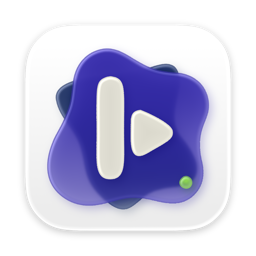
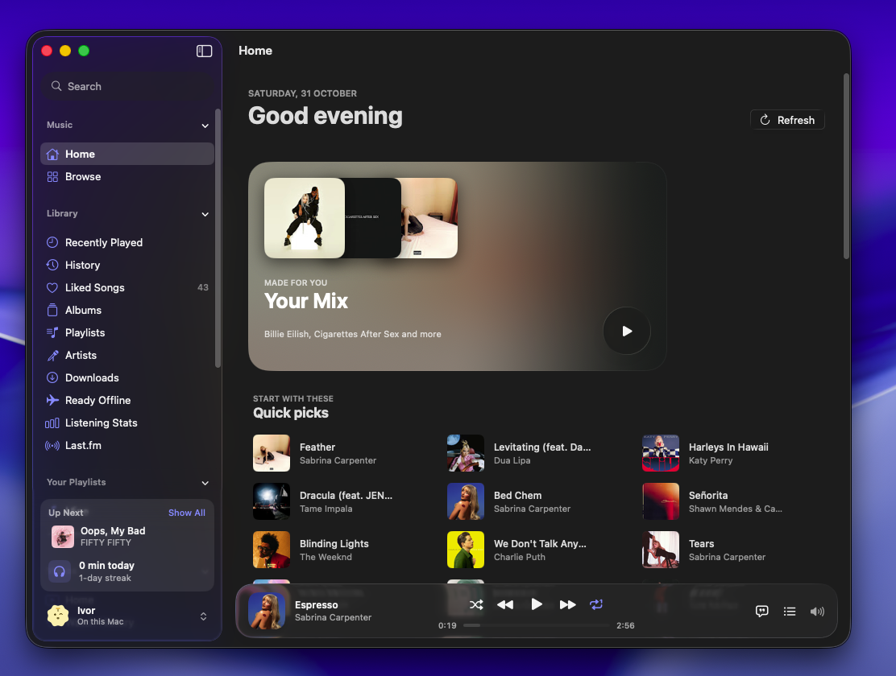
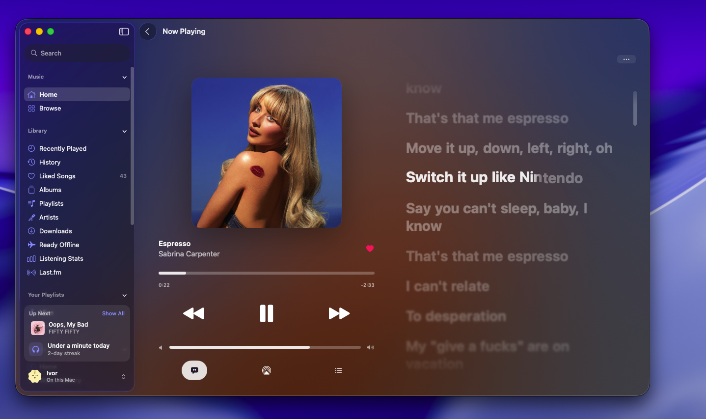
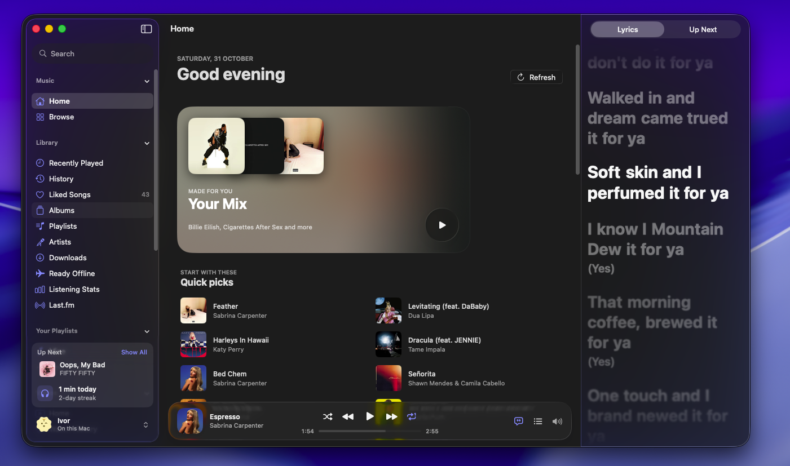
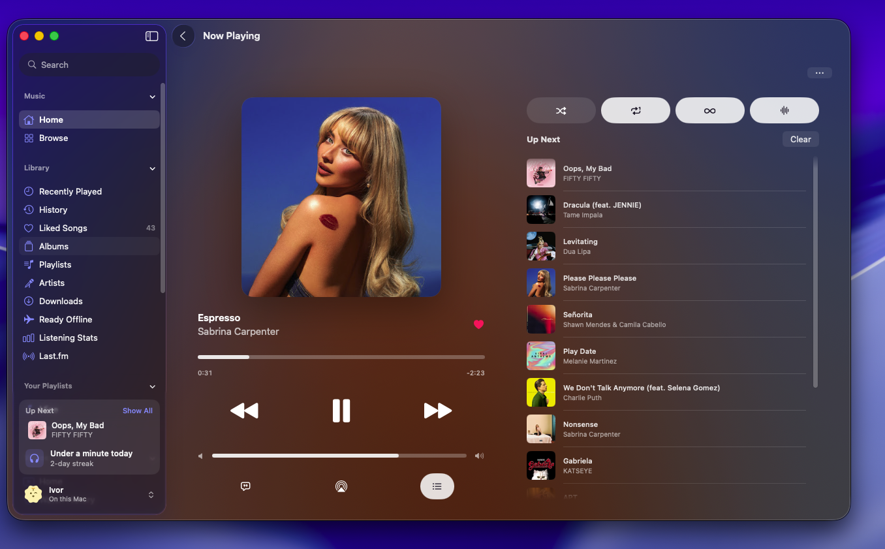
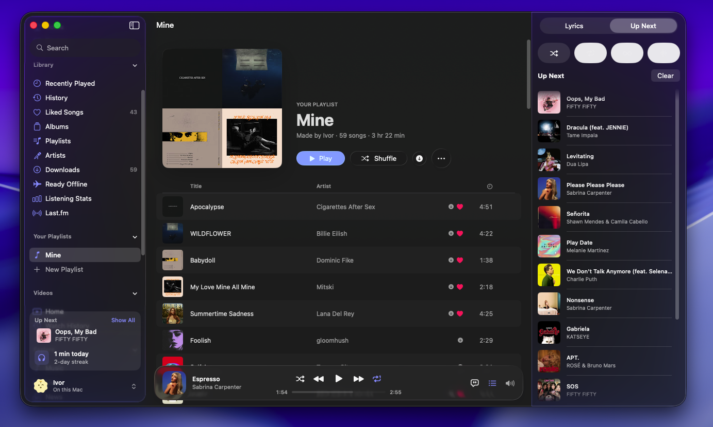
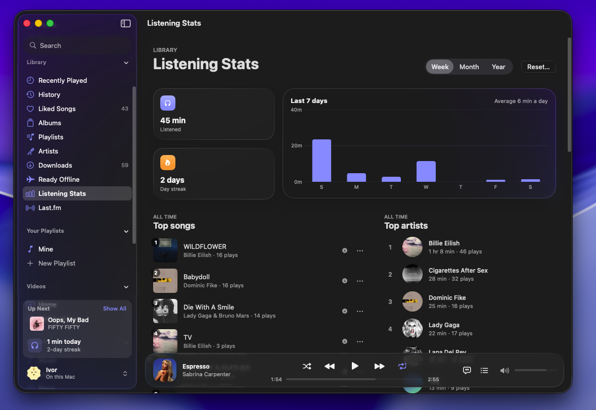
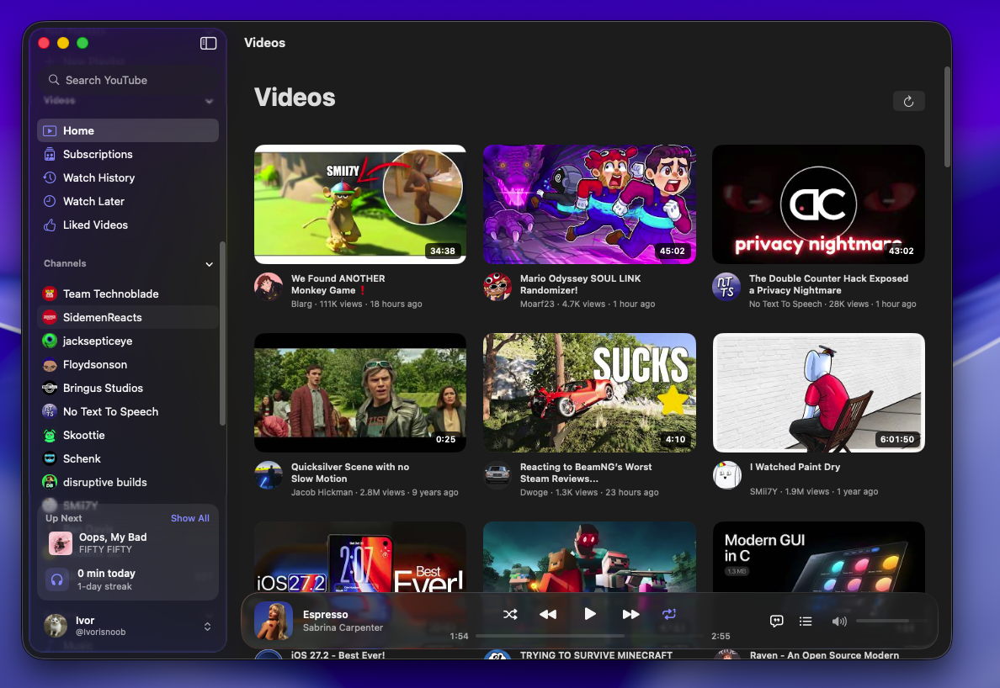
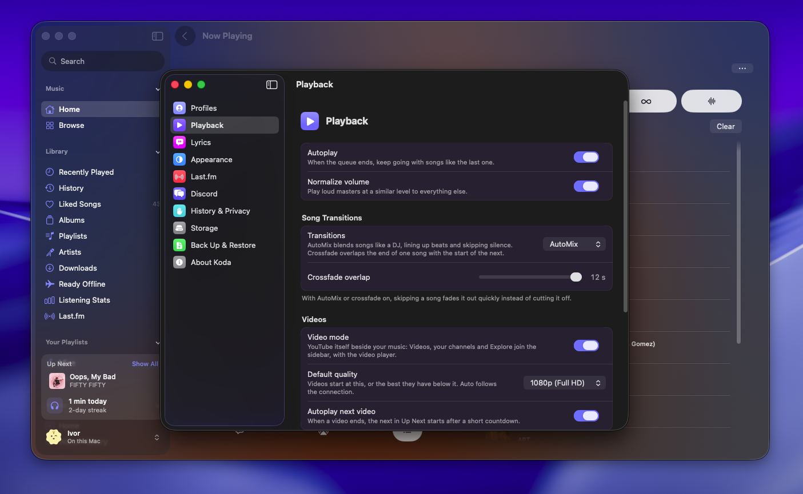

<p align="center">
  
</p>

<h1 align="center">Koda for iPhone and Mac</h1>

<p align="center">
  <b>YouTube Music and YouTube, in one app written in SwiftUI with Liquid Glass.</b>
</p>

<p align="center">
  <a href="https://github.com/Ivorisnoob/iKoda/releases/latest"></a>
  
  
  
  <a href="https://t.me/ivorisnoob_chat"></a>
</p>

Koda plays music from YouTube Music and videos from YouTube, without ads. Use it with no account at all, or sign in to bring your likes, playlists, subscriptions and history with you. It is the Apple sibling of [Koda for Android](https://github.com/Ivorisnoob/Koda), built for iPhone and Mac rather than ported to them.

## Screenshots

### Mac

<table>
  <tr>
    <td align="center"><br><sub>Home</sub></td>
    <td align="center"><br><sub>Now Playing with lyrics</sub></td>
  </tr>
  <tr>
    <td align="center"><br><sub>Lyrics beside any page</sub></td>
    <td align="center"><br><sub>Up Next</sub></td>
  </tr>
  <tr>
    <td align="center"><br><sub>Your playlist</sub></td>
    <td align="center"><br><sub>Listening stats</sub></td>
  </tr>
  <tr>
    <td align="center"><br><sub>Video mode</sub></td>
    <td align="center"><br><sub>Settings, laid out like System Settings</sub></td>
  </tr>
</table>

## Download

Get **`Koda.ipa`** (iPhone) and **`Koda.dmg`** (Mac) from **[the latest release](https://github.com/Ivorisnoob/iKoda/releases/latest)**. Koda needs iOS 26 or macOS 26 or later.

## Installing

### iPhone

Koda isn't on the App Store, so you sign it yourself with your Apple ID, using any of these:

| Tool | How |
|---|---|
| [AltStore](https://altstore.io) | With AltServer running on your computer, open AltStore on the iPhone, go to **My Apps**, tap **+** and pick `Koda.ipa`. |
| [SideStore](https://sidestore.io) | The same, without needing a computer after setup. |
| [Sideloadly](https://sideloadly.io) | Connect the iPhone to your computer, drop `Koda.ipa` in, sign in and start. |

A free Apple ID's signature lasts seven days; AltStore and SideStore renew it for you. The first time, iOS may ask you to trust your Apple ID in **Settings → General → VPN & Device Management**.

Because the app is signed with a developer account, not by Apple, iOS needs **Developer Mode** on: **Settings → Privacy & Security → Developer Mode**. It appears after the first install, takes one restart and costs nothing. Without a paid Apple Developer account there is no way around it.

If Sideloadly fails on a free Apple ID (free accounts have a small limit on app IDs, and the Quick Play widget needs its own), open **Advanced Options** and turn on removing app extensions. Koda then installs without the widget and controls.

### Mac

One app for Apple silicon and Intel. Open `Koda.dmg` and drag Koda into Applications.

Koda isn't notarized by Apple, so the first time macOS says it can't check it. Open **System Settings → Privacy & Security**, scroll down and click **Open Anyway** beside Koda. Or, in Terminal:

```sh
xattr -dr com.apple.quarantine /Applications/Koda.app
```

## Music and Video

Koda has two modes, as Koda for Android does. Switch between them from the button at the top of Home on the iPhone, or the top of the sidebar on the Mac; each has its own tabs or sidebar, and whatever is playing carries on.

## Features

### Music

- **Your Mix** on Home, woven from radios of the artists you play most; **Jump back in**, **Quick picks**, your top artists and a row of **Charts**
- Signed in, Quick picks come from your own YouTube Music Home
- Gapless playback or **crossfade**, in the background, with the Lock Screen, Control Center and AirPlay
- Shuffle, repeat, autoplay radio, and a queue you can drag, swipe and undo
- Skip buttons, a sleep timer, volume normalization, and swiping the mini player to skip

### Video

- **Home** and **Subscriptions** feeds, search, and channels with their Videos and Live tabs, sorted by Latest, Popular or Oldest, and an About page with their links
- **Explore** Music, Live, News, Sports and Learning, signed in or not
- **Watch Later** and **Liked Videos** from your account, and the channels you follow
- Like and dislike with the count, subscribe, share, and read the comments
- Koda's own player: quality (1080p by default, or Auto up to 4K), speed, captions, AirPlay and picture in picture
- **Gestures**: double-tap a side to skip 10 seconds (keep tapping to skip more), hold for 2× and slide for other speeds, swipe up for full screen and down to leave it or shrink the video into the mini player, brightness on the left in full screen, and pinch to fill the screen
- Videos **pick up where you left off**, with a progress bar on each thumbnail, and the next one plays after a short countdown
- Leave the video's page and it keeps playing in the mini player

### Your account and profiles

- Sign in to YouTube Music to sync liked songs, albums, playlists and artists both ways, and to send what you play and watch to your YouTube history
- **Profiles** for everyone who uses the device, each with its own library, history and account, and a one-tap switch between them
- A welcome on first launch that sets up your taste: artists, genres and a deck of songs to keep or skip
- **Suggest Less** for songs and artists you don't want offered again, and a full listening **History**

### Lyrics

- Word by word from YouLyPlus and BetterLyrics, line by line from LRCLIB, chosen automatically
- Duets on their singer's side, backing vocals under their line, long notes that swell
- Tap a line to jump to it; share up to six lines as a card in the song's colours

### Finding music

- Search with suggestions and filters, or by voice, recognized on the device
- Paste a YouTube or YouTube Music link to open it; `koda://` links work from Shortcuts
- Moods and genres to browse

### Your library

- Liked songs, saved albums, playlists and artists, and playlists of your own
- **Import a playlist** from Spotify or SoundCloud: tap New Playlist, choose where from, and paste the link of a public playlist; Koda finds each song on YouTube Music and lists the ones it couldn't (Spotify shows only a playlist's first 100 songs)
- **Downloads** and **Ready Offline**: songs kept on the device as you play them, to listen without a connection
- Listening stats: time listened each day, streaks, top songs and artists
- Back up the whole library to one file, or import it from Koda for Android
- An automatic copy of your library (likes, history, stats, artists) in the iPhone's Keychain, which survives deleting the app, so a reinstall brings it back by itself (same Apple ID; Settings → Back Up and Restore)

### Siri, Shortcuts and widgets

- Ask Siri or Shortcuts to play your liked songs, a playlist or anything you name, start a radio, or like the song playing; Koda's songs and playlists show up in Spotlight
- A **Quick Play** widget for the Home Screen, Lock Screen and Mac, and Control Center controls on the iPhone

### Last.fm and Discord

- Scrobble to your Last.fm profile with your own free [Last.fm API account](https://www.last.fm/api/account/create); Koda never asks for your password, and plays made offline are sent later
- On the Mac, show what you're listening to on your Discord profile

## On the Mac

Built for the Mac rather than stretched from the phone:

- A sidebar for each mode. Music: Home, Browse, your library and playlists, with Up Next and today's listening at its foot. Video: Home, Subscriptions, History, Watch Later, Liked Videos, your channels and Explore
- A player bar under every page; Now Playing opens out of its cover, with lyrics or the queue beside it
- Videos in **default** or **theater** view, as on YouTube's site, and full screen with nothing but the picture
- Settings in a window of its own, laid out like System Settings

| Shortcut | Does |
|---|---|
| Space | Play or pause |
| ⌘→ / ⌘← | Next / previous song |
| ⌥⌘→ / ⌥⌘← | Skip ahead / back within the song |
| ⌘↑ / ⌘↓ | Volume up / down |
| ⇧⌘P | Show or hide Now Playing |
| ⇧⌘L / ⇧⌘U | Lyrics / queue |
| ⌘1 / ⌘2 / ⌘F | Home / Library / Search |
| ⌘R | Refresh |
| ⌘, | Settings |

On a video's page:

| Key | Does |
|---|---|
| Space or K | Play or pause |
| J / L | Back / ahead 10 seconds |
| ← / → | Back / ahead 5 seconds |
| F | Full screen (Esc leaves it) |
| T | Theater view |
| M | Mute |

## Privacy

Koda has no analytics and no server of its own. What you like, save, play and search is stored on your device and leaves it only when you back it up, or, if you sign in, to keep your YouTube account in step. Your sign-in stays in the device's Keychain. Requests go to YouTube and YouTube Music, to the lyrics services for lyrics, and to Last.fm or Discord only if you turn them on. Pausing listening history keeps your plays from going anywhere.

## Building

Xcode 26 or later. Notes on how parts of Koda work, and why, are in [`docs/`](docs).

```sh
cd KodaCore && swift test                          # unit tests
KODA_LIVE=1 swift test --filter Live               # against live YouTube, plays muted audio
xcodebuild -project Koda.xcodeproj -scheme Koda -destination 'generic/platform=iOS' build
xcodebuild -project Koda.xcodeproj -scheme Koda -destination 'generic/platform=macOS,variant=Mac Catalyst' \
  ARCHS="arm64 x86_64" ONLY_ACTIVE_ARCH=NO CODE_SIGN_IDENTITY="-" CODE_SIGN_STYLE=Manual build
```

CI runs on Codemagic and is defined in `codemagic.yaml`; builds and their artifacts are on the Codemagic Builds page. It has three workflows:

| Workflow | Runs | Result |
|---|---|---|
| `ios-unsigned` | Every push to `main` or `beta`, and pull requests | Tests `KodaCore`, then builds `Koda.ipa` with an ad-hoc signature, for AltStore, SideStore and Sideloadly, which re-sign it with your Apple ID (free) |
| `mac-universal` | Every push to `main` or `beta`, and pull requests | A universal (Apple silicon and Intel), ad-hoc signed `Koda.dmg` |
| `ios-signed` | Only when you start it by hand | An Ad Hoc signed `Koda.ipa` for iPhones registered in your Apple Developer account. Needs a paid Apple Developer Program account, an App Store Connect API key, and a `code-signing` variable group holding `CERTIFICATE_PRIVATE_KEY`; the steps are at the top of `codemagic.yaml` |

Codemagic may pack the `.dmg` inside a `*_artifacts.zip`; unzip it first. To use it, add the repository in Codemagic, choose `codemagic.yaml`, and create the webhook in the app's settings. The old GitHub Actions workflow is gone.

| Path | What |
|---|---|
| `KodaCore/` | Swift package with no UI: the InnerTube clients, parsers, stream resolution, accounts, lyrics, the library, the queue and the player |
| `Koda/` | The SwiftUI app, with its Mac pages in `Koda/Mac` and video in `Koda/Video` |
| `KodaWidgets/` | The Quick Play widget and Control Center controls |
| `codemagic.yaml` | Codemagic CI: the `ios-unsigned`, `ios-signed` (manual) and `mac-universal` workflows |

## Feedback

Found a bug or want something? Open an [issue](https://github.com/Ivorisnoob/iKoda/issues) or say it in the [Telegram community](https://t.me/ivorisnoob_chat).

## Thanks

Lyrics come from [LRCLIB](https://lrclib.net), YouLyPlus and BetterLyrics.

The app icon is by [sameerasw](https://github.com/sameerasw).

---

Koda is an unofficial client and is not affiliated with YouTube or Google.
