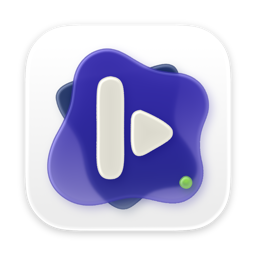
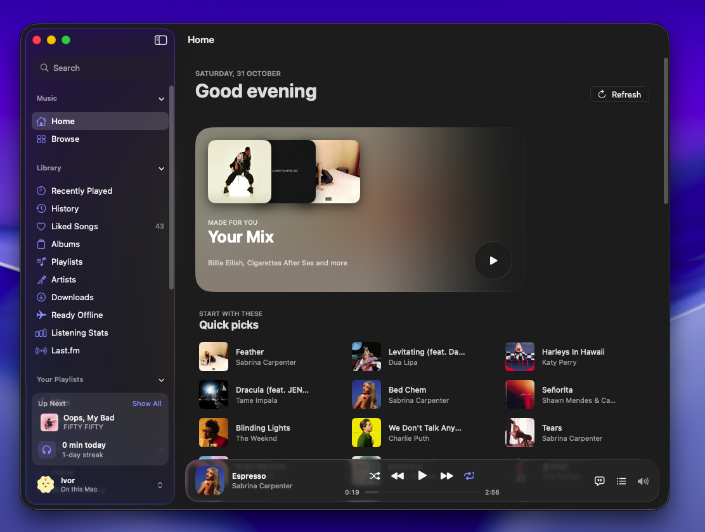
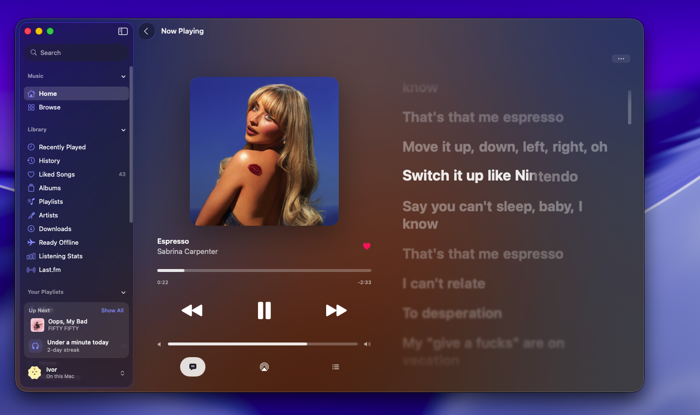

<p align="center">
  
</p>

<h1 align="center">Koda</h1>

<p align="center">
  YouTube Music and YouTube for iPhone and Mac.<br>
  SwiftUI, Liquid Glass, no ads.
</p>

<p align="center">
  <a href="https://github.com/Nushis1/iKoda-codemagic/releases/latest"><b>Download the latest release</b></a>
</p>

<p align="center">
  
  
  
</p>

<p align="center">
  
  
</p>

---

## About

This project is continued by [Nushis1](https://github.com/Nushis1).
The original project was created by [Ivorisnoob](https://github.com/Ivorisnoob): [Ivorisnoob/iKoda](https://github.com/Ivorisnoob/iKoda), Koda for iOS and macOS, a SwiftUI music player for YouTube Music with Liquid Glass.

## Install

1. Open the [latest release](https://github.com/Nushis1/iKoda-codemagic/releases/latest) and download the file for your device.
2. **iPhone:** `Koda.ipa`, installed with [AltStore](https://altstore.io), [SideStore](https://sidestore.io) or [Sideloadly](https://sideloadly.io). They sign it with your own (free) Apple ID. **Mac:** `Koda.dmg`.
3. A free Apple ID signs an app for 7 days. In Koda, **Settings → Renewal** shows how many days are left.

## Features

**Music**
- Your Mix, Jump back in, Quick picks, Charts and a Radio tab built from your own listening
- Gapless playback, crossfade or AutoMix, a ten-band equalizer, audio quality for Wi-Fi and cellular
- Autoplay radio, shuffle, repeat, a queue you can drag, swipe and undo, a sleep timer, volume normalization
- Lock Screen, Control Center and AirPlay controls, a like button on the Lock Screen, animated cover art
- Lyrics word by word or line by line, translation and pronunciation, timing you can shift, share as a card

**Video**
- Home, Subscriptions, Explore, channels, comments, Watch Later and Liked Videos
- Own player with quality up to 4K, speed, captions, picture in picture and gestures
- Picks up where you left off; keeps playing in the mini player

**Library**
- Liked songs, saved albums, artists and playlists, and playlists of your own, with a photo and description
- **Lock a playlist with Face ID**: open or play it only after unlocking
- **Blocked Phrases**: songs with a phrase in the title never show up in radio, mixes or autoplay
- **Suggest Less** for songs and artists; **Play This Song** to play one song of a playlist on its own
- **Find Duplicates** and **Suggested Songs** in playlists, and pins at the top of Library
- Search your library by title, artist or album
- Import playlists from Spotify or SoundCloud, or a backup from Koda for Android
- Downloads and Ready Offline; listening stats, streaks and a full history

**Accounts and backup**
- Sign in to YouTube Music to sync likes, playlists and history both ways
- Profiles with their own library, history and account, one tap apart
- Automatic backup of every profile in the iPhone's Keychain (history, searches, playlist locks, blocked phrases too): a reinstall brings it back
- Backup to a file, Last.fm scrobbling, Discord presence on the Mac

**Everywhere**
- Siri, Shortcuts, Spotlight, a Quick Play widget and Control Center controls
- A Mac app built for the Mac: sidebar, lyrics and queue beside the page, keyboard shortcuts, theater view

## Build

Xcode 26 or later.

```sh
cd KodaCore && swift test
xcodebuild -project Koda.xcodeproj -scheme Koda -destination 'generic/platform=iOS' build
```

Builds are made by [Codemagic](https://codemagic.io) from `codemagic.yaml`: `Koda.ipa` and `Koda.dmg` on every push to `main`, and a signed `.ipa` when started by hand. More notes are in [`docs/`](docs) and [`CLAUDE.md`](CLAUDE.md).

## Privacy

No analytics and no server of its own. Your library stays on your device; if you sign in, it is kept in step with your YouTube account. Your sign-in is stored in the Keychain.

## Credits

Lyrics from [LRCLIB](https://lrclib.net), YouLyPlus and BetterLyrics. App icon by [sameerasw](https://github.com/sameerasw).

Koda is an unofficial client, not affiliated with YouTube or Google.
